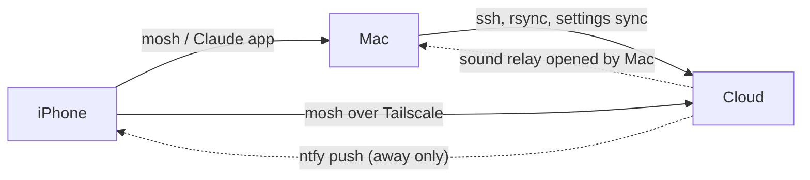

# claude-code-fleet

[](https://github.com/nicolasMazuryk/claude-code-fleet/actions/workflows/ci.yml)
[](LICENSE)

Run, monitor and secure parallel Claude Code agents across a Mac, a cloud VM and an iPhone over Tailscale. Bash + launchd/systemd tooling, ADR-driven, tested with bats.

Parallel Claude Code agents on two machines, steered from a third:

- **MacBook** (`macbook`) and **cloud** (`core-vm-cloud`, Tailscale name `cloud`) each run Agent View in tmux and one
  Remote Control server per allowlisted repo.
- **iPhone** reaches both via mosh (Moshi) over Tailscale, or the Claude app (Remote Control). ntfy pushes arrive only
  when you're away from the Mac.
- Cloud sounds play on the Mac (Choo Choo) through a relay the Mac opens; cloud can never connect to the Mac.

## Architecture



Stack: Bash, bats, shellcheck, Make, tmux, Tailscale (ACL policy with tests), systemd, launchd, jq.

## Where to start

| I want to… | Read |
|---|---|
| Understand the design | [docs/architecture.md](docs/architecture.md), [docs/spec.md](docs/spec.md), [ADRs](docs/decisions/) |
| See what is built and what is next | [Roadmap](docs/progress/ROADMAP.md), [phase logs](docs/progress/) |
| Build everything from nothing | [docs/runbooks/00-bootstrap-from-zero.md](docs/runbooks/00-bootstrap-from-zero.md) |
| Rebuild one device | [mac-rebuild](docs/runbooks/mac-rebuild.md) · [cloud-rebuild](docs/runbooks/cloud-rebuild.md) · [iphone-setup](docs/runbooks/iphone-setup.md) |
| Tailnet policy, cloud node, Mac rename | [tailscale](docs/runbooks/tailscale.md) |
| Add / remove a repo | [add-repo](docs/runbooks/add-repo.md) · [remove-repo](docs/runbooks/remove-repo.md) |
| Change Claude Code settings | [sync-settings](docs/runbooks/sync-settings.md) |
| Check it all works | [verify](docs/runbooks/verify.md) · [troubleshooting](docs/runbooks/troubleshooting.md) |
| Change this repo (agents) | [CLAUDE.md](CLAUDE.md) |

Status: built in phases, see [prompts/plan.md](prompts/plan.md) and [docs/progress/](docs/progress/).
Runbooks mark steps whose scripts do not exist yet with the phase that delivers them.

## Commands

```bash
make help          # every target
make lint test     # shellcheck + bats (brew install shellcheck bats-core)
```

Infrastructure (VM, disk, Tailscale package, Vault) lives in the separate `oci-free-tier-platform` repo (`~/Documents/oci-free-tier-platform`).

## Getting started

```bash
make lint test                 # shellcheck + bats
./install.sh mac               # idempotent; backs up ~/.claude/settings.json first
./install.sh cloud             # rsync + units over ssh (needs a reachable host named `cloud`)
make doctor                    # health check
```

## Layout

```
bin/       agent and fleet scripts      config/   sanitized Claude, tmux, Tailscale config
hooks/     Claude Code hooks            docs/     architecture, ADRs, runbooks, phase logs
tests/     bats suites + fakes          install.sh  idempotent installer (mac | cloud)
```

## Design decisions

[0001 Tailscale on OCI](docs/decisions/0001-tailscale-on-oci.md) ·
[0002 ownership split](docs/decisions/0002-ownership-split.md) ·
[0003 repo allowlist](docs/decisions/0003-repos-allowlist.md) ·
[0004 ntfy public topic](docs/decisions/0004-ntfy-public-topic.md) ·
[0005 capture/apply settings](docs/decisions/0005-capture-apply-settings.md) ·
[0006 global profile and memory in git](docs/decisions/0006-global-profile-and-memory-in-git.md)

## License

[MIT](LICENSE)
